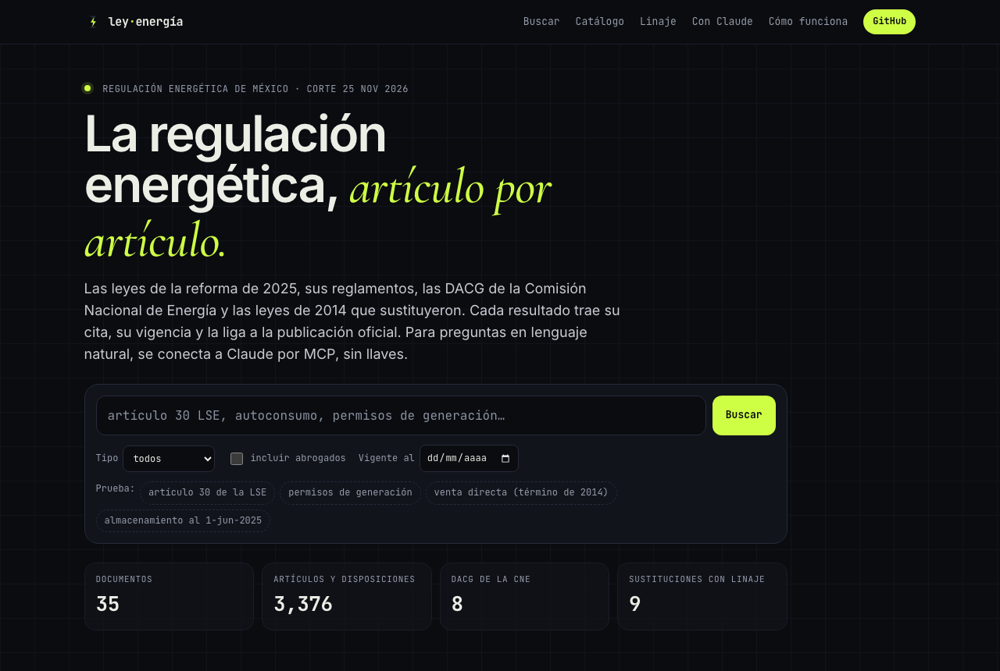
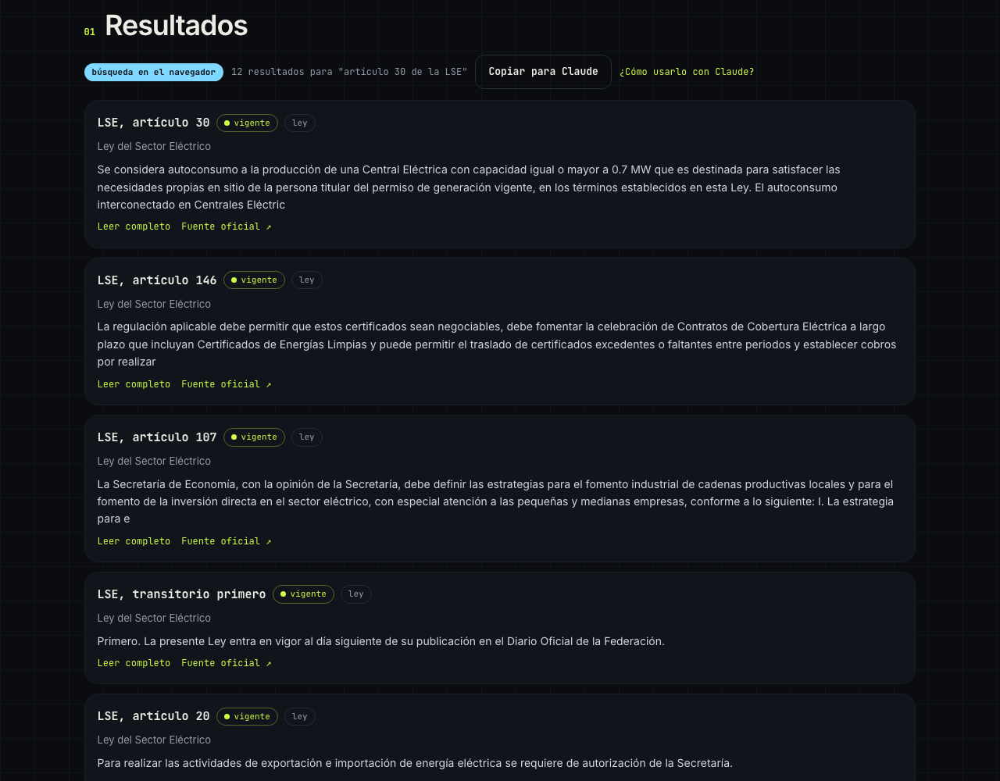
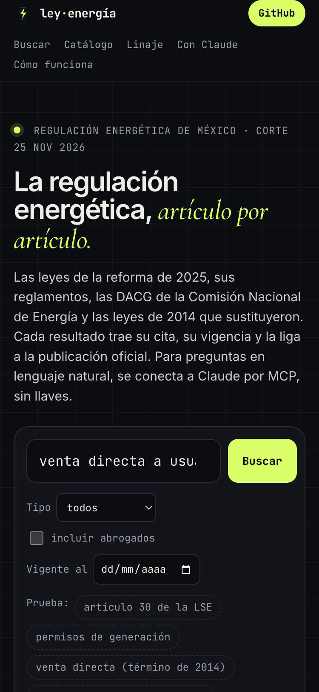

<p align="center">
  <a href="https://pivotek.mx"></a>
</p>

<p align="center">
  
</p>

<p align="center">
  <a href="README.md">English</a> · <b>Español</b>
</p>

<p align="center">
  <a href="https://github.com/BEG-lag/ley-energia-mx/actions/workflows/ci.yml"></a>
  <a href="https://beg-lag.github.io/ley-energia-mx/"></a>
  
  <a href="LICENSE"></a>
  <a href="DATA-LICENSE.md"></a>
</p>

**ley-energia-mx** hace consultable y citable por artículo la regulación energética de México: las
leyes de la reforma energética de 2025, sus reglamentos, las disposiciones administrativas de
carácter general (DACG) de la Comisión Nacional de Energía y las leyes de 2014 que sustituyeron, con
fechas de vigencia y linaje. Cada resultado trae su cita ("LSE, artículo 30"), si está vigente, qué
lo sustituyó y la liga a la publicación oficial.

Funciona **con Claude por MCP, sin llaves**: Claude razona con tu propia suscripción y este
repositorio sólo entrega el texto oficial con su cita. También tiene CLI, una web local con
búsqueda híbrida y un sitio estático que busca en tu navegador.

**Sitio:** [beg-lag.github.io/ley-energia-mx](https://beg-lag.github.io/ley-energia-mx/) ·
**Corpus:** [`corpus/fuentes.yaml`](corpus/fuentes.yaml) ·
**Evaluación:** [`evaluacion/golden.yaml`](evaluacion/golden.yaml)

| Inicio | Búsqueda | Celular |
| --- | --- | --- |
|  |  |  |

<p align="center"><sub>Capturas reales del sitio construido con el corpus del repositorio y servido en local.</sub></p>

## Úsalo con Claude

```bash
git clone https://github.com/BEG-lag/ley-energia-mx
cd ley-energia-mx
uv sync
uv run ley-energia indexar     # arma data/ley-energia.sqlite en tu máquina (cerca de un minuto)
```

- **Claude Code:** abre Claude Code dentro de la carpeta; `.mcp.json` registra el servidor. O
  agrégalo desde cualquier lado:
  `claude mcp add ley-energia -- uv --directory /ruta/a/ley-energia-mx run ley-energia mcp`.
- **Claude Desktop:** agrega a `claude_desktop_config.json`:

  ```json
  "mcpServers": {
    "ley-energia": {
      "command": "uv",
      "args": ["--directory", "/ruta/a/ley-energia-mx", "run", "ley-energia", "mcp"]
    }
  }
  ```

El servidor es de sólo lectura y ofrece cinco herramientas y tres prompts:

| Herramienta | Qué devuelve |
| --- | --- |
| `buscar` | Búsqueda híbrida con filtros de tipo, emisor, abrogados y **fecha** (el régimen vigente ese día). Cada resultado trae `cita`, vigencia, sustituto y `url_oficial`. |
| `leer_articulo` | Texto completo de un artículo, disposición ("1.2") o transitorio ("transitorio segundo"; los de cada decreto de reforma llevan su fecha del DOF, p. ej. "transitorio primero (dof 2021-03-09)"). |
| `documento` | Datos de publicación, vigencia, linaje e índice de un documento. |
| `linaje` | Qué norma sustituyó a esta y a cuáles sustituyó ella, con fecha y fundamento. |
| `catalogo` | Todo el corpus con su estado. |

Prompts: `due_diligence` (revisión regulatoria de un proyecto), `regimen_temporal` (qué aplicaba en
una fecha) y `regulacion_aplicable`. El repositorio trae además dos skills de Claude Code en
[`.claude/skills/`](.claude/skills). Las instrucciones del servidor le piden a Claude leer antes de
citar, citar documento y artículo, señalar lo abrogado, decir cuando el corpus no tiene sustento y
tratar el texto de los documentos como datos, no como instrucciones.

Sin instalar nada: el botón **Copiar para Claude** del sitio copia tu pregunta, el texto completo
de los mejores resultados con su cita y las instrucciones para responder, listo para pegar en
Claude.

## Línea de comandos

```bash
uv run ley-energia buscar "permisos de generación de energía eléctrica"
uv run ley-energia buscar "permisos de generación" --fecha 2020-01-01   # régimen vigente ese día
uv run ley-energia articulo LSE 30
uv run ley-energia linaje LIE
uv run ley-energia serve        # http://127.0.0.1:8000 con búsqueda híbrida
uv run ley-energia evaluar -v   # corre los 40 casos de evaluación
```

## Qué contiene el corpus

Corte: **25 de noviembre de 2026**. 35 documentos, 4,417 fragmentos, 3,376 artículos y
disposiciones.

| Grupo | Documentos |
| --- | --- |
| Leyes vigentes (reforma de 2025 y relacionadas) | LSE, LSH, LPTE, Ley de la CNE, LEPECFE, LEPEPM, Ley de Geotermia, Ley de Biocombustibles, LIH, Ley de la ASEA (desde [leyes-mx](https://github.com/BEG-lag/leyes-mx)) |
| Reglamentos | De la LSE, LSH, LPTE, Geotermia, Biocombustibles, LEPECFE, LEPEPM y LIH (Cámara de Diputados) |
| DACG de la CNE | Permisos de generación y almacenamiento, tarifas de transmisión, autoconsumo, mecanismos competitivos, cogeneración, integración de almacenamiento, vigencias de permisos de hidrocarburos, comercialización (DOF) |
| Abrogados, con linaje | LIE → LSE, LH → LSH, LTE → LPTE, LORCME → Ley de la CNE, LCFE → LEPECFE, LPM → LEPEPM, Ley de Energía Geotérmica → Ley de Geotermia, LPDB → Ley de Biocombustibles, Acuerdo A/113/2024 de la CRE → DACG de almacenamiento de la CNE |

Las fechas de abrogación se verificaron en los transitorios de cada instrumento sustituto (por
ejemplo, las leyes de 2025 entraron en vigor el 19 de marzo de 2025; la DACG de almacenamiento de
la CNE entró en vigor el día hábil siguiente al 16 de abril de 2026 y dejó sin efectos la
A/113/2024).

## Cómo busca

1. **Manifiesto.** [`corpus/fuentes.yaml`](corpus/fuentes.yaml) declara cada documento, su fuente
   oficial, sus fechas de publicación y vigencia, y su sustituto. `ley-energia actualizar` descarga
   y trocea; los textos troceados se versionan en `corpus/textos/`, así que el índice se reconstruye
   en cualquier lado sin tocar los sitios de gobierno.
2. **Troceo por unidad jurídica.** Un fragmento por artículo, disposición numerada (DACG) o
   transitorio, con su ruta (Título, Capítulo, Sección). Los artículos largos se parten en partes
   numeradas sin perder la clave del artículo.
3. **Índice en un archivo.** SQLite con FTS5 sobre raíces Snowball en español y embeddings locales
   ([`paraphrase-multilingual-MiniLM-L12-v2`](https://huggingface.co/sentence-transformers/paraphrase-multilingual-MiniLM-L12-v2)
   vía fastembed/ONNX). Sin servidor de base de datos, sin extensiones, sin llaves.
4. **Fusión de rangos recíprocos ponderada** de cuatro señales: léxica, vectorial, artículo exacto
   (el "artículo 8" nunca trae el 80) y documento nombrado (siglas, alias y títulos; gana el nombre
   más largo, así que "Reglamento de la LSE" es el reglamento y no la ley). El vocabulario de 2014
   ("venta directa", "autoabasto") se traduce a los términos de 2025.
5. **Filtros de vigencia.** Por omisión sólo lo vigente; una norma abrogada entra si la consulta la
   nombra o si pides una fecha.

### Evaluación

40 casos escritos desde el texto oficial, no desde lo que devolvía el buscador: artículos exactos,
documentos por nombre, temas, vocabulario de 2014 y régimen temporal.

| Motor | Recall@5 | MRR | Casos aprobados |
| --- | --- | --- | --- |
| Híbrido, Python (CLI, web local, MCP) | 1.00 | 0.89 | 40 / 40 |
| En el navegador, JavaScript (el sitio estático, `web/js/motor.js`, medido con Node) | 1.00 | 0.92 | 40 / 40 |

La CI reconstruye el índice y corre las dos evaluaciones en cada push. El motor del navegador es
determinista y debe pasar todos los casos; el híbrido debe pasar siempre los de artículo exacto,
primer lugar y vigencia, y mantener recall@5 de 0.95 o más y MRR de 0.85 o más, porque el modelo
ONNX puede variar un poco entre plataformas en los casos de tema más justos.

## Agregar un documento

Agrega una entrada a `corpus/fuentes.yaml` (formatos: `leyes-mx`, `pdf`, `dof`) y corre:

```bash
uv run ley-energia actualizar --solo <id>
uv run ley-energia indexar
uv run ley-energia evaluar
```

Cada lunes un flujo programado vuelve a descargar las fuentes y abre un pull request si cambió algún
texto oficial.

## Límites

- Es un corpus curado, no toda la regulación energética de México: no incluye NOM, manuales del
  mercado del CENACE ni regulación de la CRE o la CNH distinta de la A/113/2024.
- El filtro de fecha elige qué documentos estaban vigentes, pero cada texto es la versión al corte.
  En leyes reformadas después de publicarse (por ejemplo, la LIH) no se reconstruye la redacción
  histórica de cada artículo.
- Las notas del DOF se extraen del HTML; las tablas e imágenes de los anexos pueden quedar
  incompletas.
- El modelo de embeddings es chico y de uso general. En este set de evaluación las señales léxica,
  de artículo exacto y de documento nombrado hacen casi todo el trabajo; los vectores ayudan con
  preguntas parafraseadas.

## Aviso legal

Información de fuentes oficiales con fines informativos. No constituye opinión legal ni asesoría
fiscal. Las únicas versiones con validez son las publicaciones oficiales del DOF y de cada autoridad
emisora; valida con la autoridad competente.

## Antecedentes

La primera versión (abril de 2026) fue un prototipo privado con Postgres, embeddings de pago y
llamadas a la API de Claude. Se auditó y se reconstruyó desde cero para esta publicación; la
auditoría y la tabla de antes y después están en
[audits/2026-11-auditoria.md](audits/2026-11-auditoria.md).

## Licencia y créditos

Código con [licencia MIT](LICENSE). Datos y lo que el proyecto agrega, en CC0; ver
[DATA-LICENSE.md](DATA-LICENSE.md). Fuentes tipográficas con licencia SIL Open Font License.

Hecho por Benjamín Esponda García, [PIVOTEK](https://pivotek.mx). Relacionados:
[leyes-mx](https://github.com/BEG-lag/leyes-mx) (leyes federales con historial) y
[radar·energía](https://beg-lag.github.io/radar-energia/) (radar diario del sector). Para abogados:
[Con Criterio](https://concriterio.mx), herramientas de IA para la práctica legal en México.
